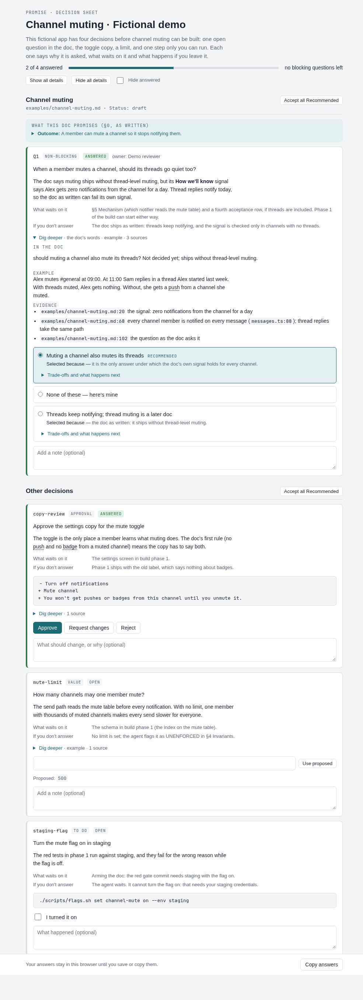

# promise

**A spec says what we will build. A promise says what we will make true for users,
and how we will prove it.**

`promise` is a Claude Code plugin for teams that ship with coding agents. You write
the outcome and the rules in your own words. The model may argue with them in
numbered notes, but it may not rewrite them — and that is enforced, not requested:
the plugin's hook blocks the edit in the session, and a GitHub Action fails the pull
request. It is a standard `SKILL.md` skill, so it also runs in Codex, Cursor and
other agents ([how](#codex-cursor-and-other-agents)). Before any code is written, your acceptance rows become failing tests,
committed on their own. When the work lands, the doc says which rules are now proven.

Start with it on day one of a new project: every promise then enters the map on the
day it is made, with the tests that prove it. You can also fit it to a product you
already have; that works, but it costs more (see [the retrofit](#or-retrofit-a-product-you-already-have)).

```bash
claude plugin marketplace add osouthgate/promise
claude plugin install promise@promise
/promise <an idea, a ticket, or a pasted transcript>
```

## Two front doors

Start from either point. Both end at the same proof.

| | **Start from an idea** | **Start from a prototype** |
|---|---|---|
| Use it when | You know what you want to be true before you build. | You build to find the idea, then want to lock it in. |
| Say | `/promise <idea>` | "I built a prototype, promise it" or "lock in what I built" |
| 1 | The model interviews you and writes one doc at `draft`. | The model reads the prototype, interviews you, and writes one doc at `draft`. |
| 2 | You check that §0 says it in your words, then type `agreed`. | You check that §0 says it in your words, then type `agreed`. |
| 3 | `/promise arm <doc>`: the rows become failing tests first. | `/promise arm <doc>`: rows for code that works are filed, not made red. |
| 4 | Build. Then `/promise reconcile`. | `/promise reconcile`: each row gets a test and a mutation watched failing, recorded as a `Kill:` line. |

What you do is the same on both doors: you write the promise and you agree it.

On the prototype door:

- Decisions in a protected category (money, security, contracts, data retention) are
  still asked while you prototype. Working code does not answer them.
- You still write and agree the promise. The prototype shows what the code does, not
  what you promise.
- Proof comes from a test seen to fail when the behaviour is broken (a watched
  mutation). A test written over code that already works passes at once, so a red run
  shows nothing. `arm` never stubs working code to force one.

Under pressure you can also build first and promise later ([deferred](#enforce-it-in-ci)).
That is for a hotfix: it skips the doc for now. The prototype door skips nothing.

### Run it unattended

A run can go without a person for most of the work: drafting the agent's half of a doc,
building, deciding reversible local choices under the loosest decision policy (`fast`),
and batching every question into one decision sheet at the end.

One thing never runs without a person: writing or agreeing the promise (§0 and
`agreed`). A promise no person made is the agent's guess, and the map would report
proof of nothing. There is no unattended mode. An unattended run stops at that step and
leaves it on the sheet.

## The smallest useful path

No config and no project setup. Four steps for the idea door:

1. `/promise <an idea, a ticket, or a pasted transcript>` — the model interviews you
   (what is true after this ships; why; what must always or never be true; how we'll
   know; one concrete example), then writes one doc at `Status: draft`. Only the
   first answer is required: with less, you get a thin draft (below).
2. You read §0, the short block at the top of the doc. It should be specific enough
   that you *could* disagree with it; when you don't, edit `Status:` to `agreed`.
   The model never types `agreed`.
3. `/promise arm <doc>` — the model branches, writes the acceptance rows as failing
   tests, commits only those test files, records `Red gate: <sha> <date>` in the
   header, and — after you have seen the red output and said yes — writes
   `Status: building`.
4. Build it. When the work lands, `/promise reconcile <PR>` re-stamps which rules
   are now tested and logs the decision. You type `shipped`.

## What you read

This is the part of a doc a founder reads in sixty seconds and can disagree with:

```markdown
## 0. TLDR
*(author: Ollie, 2026-01-01 — protected: do not rewrite, expand, or paraphrase — human)*

**Outcome:** A member can mute a channel so it stops notifying them.
**Rules:**
- A muted channel never sends a push or a badge count until it is unmuted.  → AT-1, AT-2
- Muting is per member; it never changes what other members see.  → AT-3
**How we'll know:** Ana mutes a busy channel and gets zero notifications from it
for a day, then unmutes and notifications resume.
**Scenarios:** the acceptance rows in §6 and the worked examples in §3.

Agent notes (appended, numbered — never edited into the block above; they sit
under §0 but do NOT count toward its 40-line budget):
1. Confirmed there is no existing mute primitive to reuse.
```

Everything under that block — invariants, mechanism with `file:line` evidence,
Given/When/Then rows, build phases — is derived from it by the model and checked
by a linter. The `→ AT-n` tags say which acceptance row tests each rule; `UNTESTED`
is allowed at `draft` and is a lint error once a human marks the doc `agreed`. The
whole doc this block opens is [`examples/channel-muting.md`](examples/channel-muting.md);
what a session looks like on screen is [`examples/transcript.md`](examples/transcript.md).

## Find a useful place to start

Say `/promise help me get started with Promise` for a guided interview.
It adapts to an idea before code, a new project, an established product, or
an existing Promise setup. It uses the answers you already supplied and
helps choose one workflow, a concrete success example and the next action.
You can use chat or the existing decision sheet.

For a large product, start with one feature chosen by user impact and recurring
problems. A pilot report can select capabilities with repeated `--row` flags,
and clearly labels the limits of its test and service inputs. Read the
[worked conversations and form](examples/onboarding/README.md) for examples.
Regenerate older scoped report exports so their capability selection is recorded.

## The map: proof that the promise is kept

A test suite says the tests pass. It does not say the product works. Every agreed
promise becomes a row in the project's **capability map**: the story, its
Given/When/Then scenarios, the altitude each `Then` asserts on, and the tests cited as
proof — unit, e2e or eval. `map_report.py` joins the map to a real test run (JUnit
XML, which Vitest, Jest, Playwright and pytest write, and plain unittest writes through
`scripts/junit_unittest.py`) and shows what is promised
and what is actually proven:

```
$ python3 skills/promise/scripts/map_report.py --map examples/proofmap/map.json --junit examples/proofmap/run

CAP-2  A member searches their notes and sees the best match first.  passing      UNDER-PROVEN  (map says proven)
  ├─ CAP-2.1  he sees the most recent invoice note at the top of …  [perception → e2eTests]  ✗ no passing test in its lane
  │    ✓ tests        tests/unit/search.test.ts › ranks by recency  passing
  │    ✓ tests        tests/unit/search.test.ts › returns every match  passing
…
──────────────────────────────────────────────────────────────────────────────
3 of 4 must rows not lane-green · 6 promises · 3 passing in this run · 2 lane-green · 1 under-proven · 3 not built
1 is green but not proven at the altitude promised · 1 failing · 1 cites a test that never ran · 4 are recorded higher than the run shows
1 test has no row · 6 rows have no outcome doc
```

`CAP-2` is the case that matters: every cited test passes, and the promise is still
not proven, because the sentence says what a person *sees* and only unit tests speak
to it. The map is also where an agent should look first when you ask about the
product. "Why doesn't search work?" has an answer there: the row, its verdict, and
the tests that do and do not stand behind it.

### View a rule and its evidence together

Use `render_view.py` for a local HTML page, or pass `--json` to read the
same document and evidence with a script. With no reports it shows the
Markdown and acceptance rows. It preserves §0 verbatim in JSON.

```sh
python3 skills/promise/scripts/map_report.py --map map.json --junit results.xml --json > map-report.json
python3 skills/promise/scripts/service_report.py --map map.json --observations observations.json --json > sla-report.json
python3 skills/promise/scripts/render_view.py docs/outcome.md --out outcome.html \
  --map-report map-report.json --service-report sla-report.json \
  --source-revision "$(git rev-parse HEAD)"
```

Generate both reports from the same project map snapshot. Regenerate older
reports before combining them. Run the viewer from the
project root or pass `--project-root` so it can match the map's document path.
Use `--source-revision` only when it describes the rendered document. It is a
caller-supplied label. The viewer records the render time separately.

A linked acceptance row must match the report's document, capability ID,
scenario and altitude. The page distinguishes the recorded map verdict,
computed row status and lane-level test citations. SLA evidence has its own
status and reference time. Historical replay remains labelled, and a green
lane does not establish scenario proof. Acceptance rows with no rule tag have a
separate section so their evidence stays visible. The viewer does not update the
source, map or reports. The HTML output directory must support hard links so a
failed write cannot leave an incomplete page at the output path.

### Browse the whole capability map

Generate a map report, then render every capability and its scenarios on one
local page. The page includes the recorded verdict, computed lane status, test
citations and explicit scenario evidence where the map records it.

```sh
python3 skills/promise/scripts/map_report.py --map map.json --junit results.xml --json > map-report.json
python3 skills/promise/scripts/render_map.py map-report.json --out capabilities.html
```

Open `capabilities.html` in your browser. Use its Find command to search,
choose a capability from the index, and expand the test citations or service
details. The standalone file works offline and records when it was rendered.
Report summaries and SLA details use labelled tables. Measurements, units,
evidence sources and reasons stay visible, including nested fields. Empty
collections say “None reported”, missing values say “Not reported”, and
boolean values read “Yes” or “No”.
Measurement labels include the original metric identifiers so names remain
searchable and distinct.

Pass `--service-report sla-report.json` to include service levels. Generate
that export with `service_report.py --map map.json --observations observations.json --json`
from the same map snapshot. Historical replay and service reference time remain
visible. With no JUnit run, generate the map report without `--junit` to inspect
the recorded map with test evidence marked unchecked. `--source-revision` adds
an optional caller-supplied revision label.

The output path must be new and its directory must support hard links, as with
the outcome viewer. Rendering reads the exported reports and makes no changes
to the project.

### Trial grouping by user job

The starter reader accepts a row with `"grouping": "job"` and one or more
scenarios. Keep the same capability while the actor and their outcome stay the
same. Review the grouping when the row gets hard to scan or the job's scope
changes. Existing rows and continuation links keep their current rules.
Use the updated starter reader in the trial checkout. A copy previously
generated into a project still enforces its original limit.

In a trial row, add `"evidence": ["tests/search.py::test_exact_result"]` to each
scenario, using the exact strings from the row's citation array for that
scenario's altitude. Keep the existing citation arrays for the lane checks.
`map_report.py --strict` flags missing, unresolved or ambiguous scenario
citations even when the lane is green. The report and HTML outcome viewer show
the explicit citation result separately. A passing citation still needs human
reconciliation to establish what the test actually asserts.

Replay both fictional projects with fixed stubs and historical SLA evidence:

```sh
python3 examples/simulation-prep/run_simulations.py --trial --out /tmp/promise-trial
```

Open either project's `trial/outcome.html` for the outcome and its evidence.
The `trial/functional-report.json` file covers the full map, including scenarios
added after the outcome document's acceptance snapshot.

### Service assurance: the conditions that make a capability useful

A search can work but take ten seconds; a checkout can work but be inaccessible.
Optional shared `servicePolicies`, referenced by capability rows, describe the
conditions a service must meet. Quantitative metrics can have target, conditionally
acceptable and unacceptable bands; qualitative criteria can use pass/fail without
an invented score. Correctness and other hard constraints cannot be traded away.

[`service_report.py`](skills/promise/scripts/service_report.py) evaluates bounded
numeric observations or records explicit, cited assessments. It keeps service
status separate from functional proof, and missing or stale evidence stays unchecked.
Search speed, availability, capacity and accessibility are illustrations, not a
closed list of service promises. See the [service-assurance contract](skills/promise/references/service-targets.md)
and the [runnable examples](examples/service-targets/README.md).

Each row gets one bucket, worst first: `failing`, `bad-citation`, `never-ran`,
`skipped`, `not-run`, `passing`, `external` (only another repository's tests) or
`no-test`. `not-run` means a lane's whole suite is missing from this run, such as an
e2e suite written by its own command. The report then says `<lane> was not in this
run (N citations not checked)`, and the JSON lists the lane in
`summary.lanesNotInRun`. Those citations prove nothing. `--strict` does not fail on
them, only on a verdict recorded higher than the run shows. Join that suite's JUnit
too. A suite is in the run when the run holds a case in the folder of a file the lane
cites, or in a subfolder of it, so a lane whose every cited file was deleted reads
`never-ran` and fails `--strict`. A run file named after a folder of the cited path
(`e2e.xml` for `e2e/tests/`) also places a path recorded from that folder
(`admin/new.spec.ts`) and a sibling folder under it (`e2e/smoke/`). The limit: any
other run file cannot place those, and a unit run named after a folder of a lane's
path (`web.xml` beside `packages/web/e2e/`) is read as that lane's suite.

A skipped test proves nothing, but `--strict` fails only on a verdict recorded higher
than the run shows: a row recorded `under-proven` passes with one of its tests skipped.
To allow no skipped cited test, add `--fail-on-skipped` (to `map_report.py` or
`check.py`). It lists each skipped citation with its row and lane, and exits 1 on one.

### Start from scratch: the cheapest time

The best time to start is before the first piece of work. On a new project:

1. `/promise adopt` — the config, the `CLAUDE.md` block that routes every agent here,
   and (on your yes) the CI check.
2. Every change starts as `/promise <idea>`. A thin draft is enough on day one.
3. When you agree the first doc, `arm` offers the starter map. Say yes. Its rows go
   in red first, on their own commit.
4. Build until they go green. `reconcile` promotes a row only when a test at the
   altitude its `Then` promises passes. Run `map_report.py --strict` in CI.

Each promise enters the map on the day it is made, with the tests that prove it, so
the map never has to be rebuilt and never falls behind the code. The gap in the
retrofit below never opens: no change is done until its own row is proven.

### Or retrofit a product you already have

We fitted `promise` to a real product after the fact: a large codebase across two
repositories, where agents had written about 16,000 tests. The suite was green. The
product did not work when we used it.

Agents wrote the map of what the system does today: every capability, with the tests
that prove it. It took several passes, because each pass missed parts of the code and
an independent reviewer sent rows back. The first honest report read:

| | Capabilities |
|---|---:|
| In the map | about 240 |
| With a named test that passed in the run | more than 200 |
| **Proven at the altitude the capability promises** | **fewer than a third** |

More than 200 green; fewer than a third proven. The gap was exactly the list of
things that "worked" in the suite and not in the product. Now a new change starts as
a promise, its rows go in red first, and a row is promoted only when a test at the
right altitude goes green and a watched mutation makes it fail again. When something
does not work, the reason is a row in the map.

The retrofit worked, but it took several passes over a large codebase to build the
map that a new project gets one row at a time. If you are starting something new,
start with `promise`.

`/promise backfill` is that retrofit as a mode. It runs three sweeps, feature by feature:

1. **Every test has a home.** Each test case in a JUnit run goes to the row whose
   scenario it proves, or starts a new row. `map_report.py --orphans` lists the tests
   no row cites, so "done" is an empty list, not a feeling.
2. **Every entry point has a home.** A command you configure (`map.surfaces`) prints
   the product's routes, pages and jobs from the code. `map_report.py --surfaces`
   lists the ones no row names. A route with no test becomes a `not-built` row of its
   own, never a line in a tested row: code in production that nothing proves, now
   visible.
3. **Legacy docs move in.** A design doc for one capability becomes an outcome doc at
   `draft`, its §0 made of verbatim quotes from the old text, each citing its line at
   a commit and waiting for your confirmation. With your yes, the legacy file is
   deleted in the same commit. If you keep it, it is cut to one line that points at
   the outcome doc, and nothing else stays (`check.py` warns while it holds more).

A different agent verifies every row the writer proposes. Backfilled rows say what the
code does today (`origin: backfill`); they become promises only when you agree an
outcome doc that cites them. A row reaches `proven` only through `reconcile`, one
scenario at a time, each on a test that asserts its `Then` and was watched dying. The
report's computed `proven` is not proven: it joins tests to scenarios by lane, so one
test can turn a whole lane green.

## Start thin

You do not need every answer to start. When you have the outcome line but not yet
the rules, the signal or an example, `/promise` offers a **thin draft**: `Status:
draft` with `Depth: thin` in the header, §0–§2 in your own words, and §3–§7 marked
"not written yet". Each gap becomes a BLOCKING question in §9, never a line the
model wrote for you. The idea is in version control the same day.

A thin draft cannot be agreed: the lint rejects `Depth: thin` on any status past
`draft` (`THIN_DRAFT`). When the questions have answers, `/promise revise <doc>`
writes the agent half and removes the line. The gates after that are unchanged.

## Answer the decisions in one place

When a run ends with decisions only you can make (BLOCKING questions in §9, a draft
to approve, a value to pick, a step only you can run), the skill does not leave them
as a list at the end of a chat reply. It puts them on the best surface the agent has:

- **A pane inside Claude Code** (the terminal, or the Desktop app's Code tab; Claude
  Code v2.1.287 or later), when the plugin is installed: one picker per decision, with
  the Recommended answer marked and a field for a note or your own words. **Save
  answers** writes them and hands the rest back to the agent. `/promise-decide` opens it
  yourself. It is a [mod](https://code.claude.com/docs/en/plugins/mods/overview),
  `hooks/decisions-pane.js`; where nothing draws, the surfaces below are used.
- **A rich decision sheet** for more than four decisions, or any that need a diff, a
  diagram or more detail. In Claude it is a published Artifact. You pick options
  (the Recommended one is first, with its reason), approve or reject, fill in values
  and tick off steps, then press **Save answers for Claude**. On a host with a canvas
  that renders HTML, the same page has **Copy answers** to paste back.
- **The agent's own question prompt** for up to four simple choices, and in batches
  of four on a host with no rich surface.
- **One chat message** in a chat that shows only text: numbered items and lettered
  choices, answered with a short reply like `all recommended` or `1a 2c`.

[](examples/decisions/)

`decisions.py sheet` builds the sheet from the open §9 questions and a short asks
file the agent writes, so each sheet is quick to make. `decisions.py apply` writes
each answer into the doc as one dated line under its question. It never changes §0
or the status: that stays your edit. `references/decision-sheet.md` has the
procedure. [`examples/decisions/`](examples/decisions/) holds the sheet above, made
from `asks.json`: the page, the chat message, the GitHub comment and screenshots.

## Why "promise"

An outcome doc *makes* a promise; a proven row *keeps* it; a defect *breaks* it.
A promise has an owner, a person it is made to, and a result you can check. A
spec, an intent or a plan does not have all three.

Each change starts as a promise in plain words — "a muted channel never sends a
notification". The model cannot change those words; it can only argue with them in
notes. Before the build, the promise becomes failing tests. When they pass, the
promise is kept. When a bug appears, you know which promise it broke.

An `intent.md` records what you want; a promise records what you commit to and how
you will prove it. A thin draft is the intent stage of a promise.

## What a script checks, and what is an instruction to the model

| Enforced by a script (deterministic, exit code) | Where |
|---|---|
| Doc shape: header, headings, §0 budget, rule format and tags, tag resolution, scenario counts, why-lines, placeholders, `UNTESTED` on `agreed`, §6 cells split where GitHub splits them (a pipe inside a cell is written `\|`), a §5 Load-bearing premises table row missing its Evidence or Existing join searched cell | `lint_outcome.py` (stable rule ids; one-change fixtures under `tests/fixtures/`) |
| An unlisted negative claim in §1 or §5 ("can't", "cannot", "doesn't have", "no way to", "unavailable", "only X has") outside a §5 Load-bearing premises table, unless a COMPLETE row's Premise cell quotes it or the line is marked `<!-- not a premise -->` | `lint_outcome.py PREMISE_PHRASE` (warning — a wording heuristic, not a reading of the sentence; the coverage match is literal, not semantic) |
| A `Decision policy:` line reads `fast`, `auto` or `spec` (`prototype` is read as `fast` and warned as `DECISION_POLICY_ALIAS`); an agent decision in §8 (Owner `agent`) records its category, reason, rollback, reversible-until, a concrete review trigger and its state; none in a protected category, and none under `spec` (or with no line) left provisional | `lint_outcome.py DECISION_POLICY`, `AGENT_DECISION_FIELDS`, `AGENT_DECISION_PROTECTED`, `AGENT_DECISION_UNRATIFIED`; `AGENT_DECISION_WORDS` warns on a protected word in a local decision |
| A thin draft (`Depth: thin`) stays a `draft`, with §3–§7 not written yet (a seed example aside); past `draft` the full shape applies | `lint_outcome.py THIN_DRAFT` |
| §0 of an `agreed`, `building` or `shipped` doc changes only in its rule tags and `Scenarios:` count, unless the same change sets `Status: draft` | `diff_outcome.py S0_CHANGED`: the plugin's PreToolUse hook blocks the model's edit before it happens; for other agents, the git pre-commit hook (`install_skill.py --git-hook`, or `promise-section0` in `.pre-commit-hooks.yaml`) blocks the commit; the GitHub Action fails the pull request |
| Every §6 row names the altitude its `Then` asserts on: `data`, `response`, `perception`, `judgement` or `sibling` | `lint_outcome.py ACCEPTANCE_ALTITUDE`; a table with no `Altitude` column is `ALTITUDE_MISSING`, a warning, so older docs keep linting |
| A `building` doc carries a `Red gate: <sha> <YYYY-MM-DD>` line of the right shape | `lint_outcome.py BUILDING_NEEDS_GATE` |
| A `shipped` doc carries proof that each §6 line was seen to fail: the line went red (a `Red gate:` line, the line not in `Filed without red run:`), a `Kill:` line names it (a watched mutation), or it cites a row with `origin: backfill` and `verdict: proven`; the kill record lines are well formed and name only §6 lines | `lint_outcome.py SHIPPED_NEEDS_GATE` (a line none of these covers, with no `Row`), `KILL_RECORD_FORMAT`, `KILL_RECORD_UNKNOWN`; `bridge_validate.py SHIPPED_WITHOUT_GATE` (a row that is not a proven backfilled row), which `check.py`'s gate step runs on each doc with such a line, in the Action too; with no map (`"map": null` or `false`) the gate step fails such a doc, since no row can be proven |
| A bridged doc's `Row` ids, snapshot line and `Then` text against the map's current text (a bridged doc is one whose §6 rows `arm` has filed into a map) | `bridge_validate.py` |
| A §6 line links a row only when its `Then` equals one of that row's scenarios, case and whitespace aside, at the same `Altitude`, when `map.row` prints the row as JSON (the starter map does; a map that prints text gets `ROW_TEXT_ONLY`, and the link is checked by hand) | `bridge_validate.py --linking`, which `arm` runs: `THEN_NOT_IN_MAP`, `ALTITUDE_NOT_IN_MAP` |
| Project commands run with the caller's text as one argv element, never a composed shell string — inline or read from a file (`--query-file`, `--search-file`) | `adapter.py`, `outcome_rows.py` |
| A partial map is refused, not run: when `orient.py` reports `mapUsable: false`, `adapter.py` refuses (exit 2) and `bridge_validate.py` reports `MAP_NOT_CONFIGURED`, both naming the missing keys | `orient.py`, `adapter.py`, `bridge_validate.py` |
| Config key names, field types, paths that escape the project, configured paths that are not on disk, `rowIdPattern` compilation, a `branch`, `docsHome` or `map.junit` that a shell would misread | `orient.py` `warnings[]` |
| Every test in a run has a row (or a reasoned `leftOut` entry naming that one test exactly), and every entry point the code lists has a row | `map_report.py --orphans --fail-on-orphans`, `--surfaces --fail-on-unmapped` |
| No test a row cites was skipped in the run (`--strict` alone passes a skip on a row recorded at or below what the run shows) | `map_report.py --fail-on-skipped`, `check.py --fail-on-skipped` |
| The Action's checks (lint, §0, the skipped red gate), the map's own checks, the entry-point list, and the map against a run, as one local command for projects that cannot run Actions | `check.py` |
| A doc's `Supersedes:` paths are deleted, or cut to one line that names the doc (a folded doc at `superseded-by` aside) | `check.py`, as a warning: a human may keep a file on purpose |
| Which rows a change added, changed, removed or touched, the outcome docs it changed, and the changed files no row names | `changed_rows.py` (the map at the merge base against the map at the head) |
| An issue's or a pull request's promise block has its sections, stays in its word budget, keeps code out of the people section, links an issue, names one to three `path:line` places, starts each ask with its relation, writes the map's verdicts, and names every row the change moved | `lint_github_text.py` |

| Followed by the model — not yet script-enforced | Where the rule lives | Planned script |
|---|---|---|
| A row is promoted only after a watched kill (mutation → test fails → revert → passes) | `modes/intake.md`, `modes/reconcile.md` | `kill_witness.py` |
| `arm`'s git preflight, red run, and test-only red-gate commit | `modes/arm.md` | `arm_gate.py` |
| `agreed` and `shipped` are typed by a human, never by the skill | `SKILL.md`; the wording is locked by `tests/test_status_authority.py` | — |
| An agent decision's category is the true one, every condition for deciding alone holds, and the agent asks when unsure; `new` takes the repo's `decisionPolicy` and never asks it | `outcome-framework.md` § Decision policy (with examples on both sides of the line), `modes/new.md`, `modes/revise.md`, `modes/arm.md` (`decisions.py recheck`) | — |
| Configured project commands run only after `adapter.py show` has been printed and you have said yes, once per session | the router's first step, orient (`SKILL.md` § Phase 0); `references/config.md` § Trust model | — |

Until the planned scripts ship, `references/anti-rationalizations.md` is the guard on
the second table.

## The shape of a doc

```
§0 TLDR        ← protected human block (a mode rule; see the table above): outcome line,
                 rules as bullets (each tagged → AT-n or UNTESTED), how-we'll-know,
                 scenario count. ≤ 40 lines.
§1 Problem     · §2 Outcome     · §3 Worked examples
§4 Invariants  · §5 Mechanism   · §6 Acceptance (AT-n rows, each with an Altitude; a Row column, added or filled once bridged)
§7 Build phases · §8 Decisions · §9 Open questions · §10 Out of scope
```

## Modes

| Invocation | What it does |
|---|---|
| `/promise <idea, ticket, transcript>` | **new** — interview first, then one outcome doc at `draft` (a thin draft when only the outcome line is known) |
| `/promise onboard` | **onboard** — choose one useful workflow from your starting point, preview its evidence and next action, then continue with the existing mode |
| `/promise revise <doc> <change>` | **revise** — evolve a doc; §0 changes go through the human, with the status consequence stated first; fills a thin draft's agent half |
| `/promise review <doc or paste>` | **review** — apply the framework as a code-verified rubric to a doc authored elsewhere; paste-ready findings |
| `/promise merge <docs…>` | **merge** — one doc per capability: fold siblings into a survivor, delete the rest, with the user's yes |
| `/promise arm <doc>` | **arm** — `agreed → building`: commit the §6 rows as failing tests first and record the red gate in the doc; with a map, also file them as not-built rows and cite each test in its lane |
| `/promise intake <feedback>` | **intake** — feedback in, promise changes out: match each item to an existing §6 row (or map row), route it, draft the scenario, name the test and the mutation that would break it |
| `/promise reconcile <PR, branch, test file>` | **reconcile** — the work shipped: re-stamp §0's tags and log the decision; with a map, move a row's verdict only when the evidence reaches the altitude its own `Then` claims |
| `/promise backfill` | **backfill** — fit promise to a product that already exists: every test and every entry point gets a row (tests first, then the routes and pages no test covers), a different agent verifies each row, and legacy design docs move into outcome docs with a verbatim, pending §0 |
| `/promise issue <number or ask>` | **issue** — check an issue against the map before anyone builds it: the rows each ask touches and their verdicts, the gap in the code today, and the `/promise` steps the build agent takes, in a block below the asker's own words |
| `/promise pr` | **pr** — write the part of a pull request a reviewer reads: what changes for people in a few plain sentences, the issue it closes, every row the change moved with its verdict, and one to three `path:line` places to read first |
| `/promise retro` | **retro** — tell promise what went wrong: `session_report.py` reads the session's transcript for facts (files never read, scripts that failed or repeated, a sheet sent as a file), and the mode drafts one issue for this repository with every project name scrubbed, filed only on your yes |
| `/promise adopt` | **adopt** — set a project up: write `.claude/promise.config.json` and a short `CLAUDE.md` section that routes every agent and person to this skill |
| `/promise upgrade` | **upgrade** — move this repository to the latest promise release in a pull request of its own: every pin site to the release tag, the config's missing keys, this machine's plugin, the `CLAUDE.md` section refreshed by the new release's `adopt`, the checks run, and the step each machine runs after the merge |

Say what you want in plain words. A leading mode word is a shortcut, never a
requirement: the skill infers the mode, says which it picked, and asks only when
two are genuinely plausible.

## Adopt a project

Run `/promise adopt`. It writes `.claude/promise.config.json` if there is none and
inserts a short fenced section into `CLAUDE.md` so every agent and person in the
repo is routed to `/promise` before writing a design, plan or spec by hand. Both
steps are idempotent; `adopt.py --dry-run` shows the diff first. Every field is
optional. This is the whole config most projects need:

```json
{
  "version": 1,
  "docsHome": "docs/designs",
  "commands": { "typeCheck": "pnpm type-check", "test": "pnpm test" },
  "map": null
}
```

`"map": null` means no map yet: `arm` offers to start one when the first doc is
agreed. When a repository keeps no map on purpose (its promises are rows in another
repository's map, say), set `"map": false` by hand: no mode then offers the starter
map, and `start_map.py` refuses.

## Enforce it in CI

The plugin's hook guards the model's own edits. To guard every change on a pull
request, whoever made it, add the Action (`/promise adopt` offers to write this file):

```yaml
# .github/workflows/promise.yml
name: promise
on:
  pull_request:
jobs:
  promise:
    runs-on: ubuntu-latest
    steps:
      - uses: actions/checkout@v4
      - uses: osouthgate/promise@v1
```

It lints every outcome doc, and fails when §0 of an `agreed`, `building` or
`shipped` doc changed in anything but its rule tags and `Scenarios:` count without
going back to `draft` (the Action runs `scripts/check.py`; a project that cannot run
Actions runs the same command locally, before a push). It also fails a `shipped` doc
with a §6 line that did not go red and has no `Kill:` line, when it cites a row that is
not a proven backfilled row (`check.py`'s gate step runs `map.row` for such a doc, so the map reader must run
in CI):

```
docs/designs/channel-muting.md:18: S0_CHANGED §0 changed while Status: is agreed (was agreed); …
(was '- A muted channel never sends a push or a badge count until it is unmuted.',
 now '- A muted channel never sends a push or a badge count until it is unmuted or a day passes.')
```

The check cannot tell who made a change: a person's edit to an agreed §0 fails the
same way, and the fix is the same — set `Status: draft` and agree it again.

With no `docs-home` input, the Action reads `docsHome` from the project's config,
as a local `check.py` with no flag does, so the two lint the same folder. Set
`docs-home` only to lint a folder the config does not name, and then pass the same
value locally: `check.py --docs-home <folder>`.

A pull request whose body says `Size: tiny` claims it keeps every promise. With
`tiny-check: "true"` (and `fetch-depth: 0` on the checkout, for the merge base) the
Action checks that claim with `changed_rows.py --body`: it fails when the diff changes
a row's scenarios, a doc's §0 or §6, a migration or schema file, or a path the config's
`protectedPaths` lists, read from the config at the merge base so the change cannot
loosen its own check. The workflow `/promise adopt` writes turns it on; it is off by
default.

Under pressure you can build first and promise after. Say so ("ship it first",
"hotfix", "spike", "promise it later") and the change is **deferred**: no doc, row or
mode, while every decision in a protected category is still asked. The pull request
says `Size: deferred — owes: <each promise it touched or made>`, and its block needs
only "Why" and "Proof". `/promise reconcile` with no input lists what is owed
(`deferred.py`), pays it (rows, tests, a mutation watched failing), and marks the block
`Paid:`.

## Issues and pull requests a person can review

A reviewer reads a change in three steps: the issue says what a person wanted, the
capabilities say which promises moved and how far their proof got, and the code
delivers them. `/promise adopt` offers two GitHub templates for this, each with an
empty block between promise markers that the skill fills:

- `/promise issue 42` reads the issue, matches each ask against the map (the same
  match step as `intake`), and writes a block below the asker's own words: each ask
  with its relation (`EXTEND`, `NEW-ROW`, `DEFECT`, …), the rows it touches with links
  and verdicts, the gap in the code today with `file:line`, and the `/promise` steps
  the build agent takes next. It files nothing in the map.
- `/promise pr` runs `changed_rows.py` for the facts, then writes one to three plain
  sentences on what changes for people (no code names; at most 20 words a sentence),
  the issue it closes, every row the change moved with its verdict before and after,
  and one to three `path:line` places to read first. The full row diff goes in a
  `<details>` block.

Both open with a first screen for a reader who comes back after a few days, from
other work: **Where this is** (the parts of the product, one plain sentence each, and
what is needed from the reader) and **Words** (the product's own words, explained). An
issue gets it as a `<!-- promise:intro -->` block above the asker's words. The names
and meanings come from the map's optional `features` (a row's `feature` names one; the older
`areas` and `area` mean the same) and
`glossary`, so every issue and pull request uses the same ones.

The text is short on purpose. A reviewer who meets a wall of text asks a model to read
it, and then no person has reviewed the change. `lint_github_text.py` holds the block
to its budget; `references/github-text.md` gives the shape and the plain-words rules,
which come from ASD-STE100, and `references/first-screen.md` the first screen.
`post_github_text.py` posts a body with `gh` only when it passes the lint, then reads back
what GitHub stored (links wrapped in backticks on the way are named). A plugin hook does
the same check before a GitHub MCP tool or a `gh pr|issue create|edit` posts, and asks
before a new issue or pull request with no block. `adopt --github-templates` writes the
two templates a project lacks, a `"map": false` project included.

## Setting up the map

You do not need a map on day one. `arm` offers a starter map (`map.json`, its reader
and a recipe) when your first doc is `agreed`; a project that keeps its own register
points the config at that instead. With a map, `arm` files the acceptance rows into it,
`intake` routes feedback onto existing rows, and `reconcile` moves a row's verdict
only when the new evidence reaches the altitude its `Then` claims, after a mutation
was watched to make the cited test fail. [`examples/minimap/`](examples/minimap/) is
a three-row map you can run the bridge against.

An agent asks the map "is there a promise for this?" with `find`. The starter reader
ranks rows with BM25 over each row's title, story and scenarios, and says why each
one ranked. When `find` missed a row, `intake` teaches the map the words it missed by
(`learn`, kept only if the row then ranks in the top three). `reconcile` records which
merged pull requests named each row (`refs sync`). `--code <id>` names the files a row's
tests import, so an agent reads those before a wide code search. `--eval` checks all
of it against the titles of real work items.

Full contract: [`references/config.md`](skills/promise/references/config.md).
Design of the skill itself: [`references/architecture.md`](skills/promise/references/architecture.md).

## Seven words

| Word | Meaning |
|---|---|
| **outcome doc** | The one document per capability, in the Outcome Framework shape. |
| **§0** | Its protected human block: outcome line, rules, how-we'll-know, scenario count. ≤ 40 lines. |
| **AT-n** | A doc-local acceptance-row id in §6. Stable, append-only. |
| **red gate** | The commit that contains only the failing tests; its sha in the header is what `building` records. |
| **altitude** | What a `Then` asserts on — `data`, `response`, `perception`, `judgement`, or `sibling` for a claim about another capability — and therefore the only kind of test that can prove it. |
| **thin draft** | A `draft` with `Depth: thin`: the human half only, each gap a BLOCKING question. It cannot be agreed; `revise` fills it. |
| **capability map** | A project's own register of promises and the tests that prove each one; `map_report.py` joins it to a test run. The map terms (row, lane, recipe, snapshot line, kill witness) are in [`references/architecture.md`](skills/promise/references/architecture.md) § Vocabulary. |

## What's in the box

```
skills/promise/
  SKILL.md                 the router — contract summary, mode table, Phase 0
  VERSION                  the plugin's version, so a vendored or linked copy of the skill carries it
  outcome-framework.md     the contract for the doc: section rules, lifecycle, rubric; points at the template
  modes/                   one file per mode, loaded only when that mode runs
  references/              quickstart.md · architecture.md · slates.md · altitude.md · anti-rationalizations.md · config.md · github-text.md · first-screen.md · decision-sheet.md
  templates/               outcome-doc.md · promise.config.example.json · claude-md-section.md · decision-sheet.html · starter-map/ · github/ (issue and pull request templates)
  agents/                  openai.yaml — Codex skill metadata for the same skill
  scripts/                 orient.py · lint_outcome.py · outcome_rows.py · adopt.py · adapter.py · render_outcome.py · framework_section.py · bridge_validate.py · start_map.py · map_report.py · diff_outcome.py · check.py · changed_rows.py · lint_github_text.py · post_github_text.py · decisions.py · junit_unittest.py · install_skill.py   (Python 3, stdlib only)
hooks/                     hooks.json + guard_section0.py (Claude Code, before an edit) · guard_github_text.py (before a GitHub post) · precommit.py (git, before a commit) · decisions-pane.js (a mod: the decision pane)
action.yml                 the GitHub Action · .pre-commit-hooks.yaml for the pre-commit framework
examples/                  channel-muting.md (a lint-clean doc, not a fixture) · key-tabs.md (a doc under `Decision policy: auto`, with agent decisions in §8) · transcript.md (one annotated session) · minimap/ (a three-row capability map with its find/row/next-id script and config) · proofmap/ (a six-row map with a JUnit run: every outcome map_report.py shows) · decisions/ (an asks file and the decision sheet made from it: page, chat message, comment, screenshots)
tests/                     unit tests and one-change fixtures for the lint rules
```

## Scripts

Run these from the root of this repo (inside an adopted project,
`${CLAUDE_SKILL_DIR}` replaces `skills/promise`). They point at the shipped fixture
`tests/fixtures/conforming.md`; substitute a doc under your `docsHome`.

```bash
python3 skills/promise/scripts/orient.py --mode new                                   # the project, as one JSON object
python3 skills/promise/scripts/lint_outcome.py tests/fixtures/conforming.md           # every shape rule; stable ids; exit 1 on an error finding
python3 skills/promise/scripts/outcome_rows.py tests/fixtures/conforming.md --json    # §0 rules + tags, §6 rows with their altitude
python3 skills/promise/scripts/framework_section.py "The contract" "Lifecycle"        # only the sections a mode needs
python3 skills/promise/scripts/outcome_rows.py --search "muted channel still notifies" --dir examples   # which promise covers this?
python3 skills/promise/scripts/lint_outcome.py --template skills/promise/templates/outcome-doc.md   # the bundled template itself; exit 0
python3 skills/promise/scripts/adopt.py --dry-run                                     # the config + CLAUDE.md section it would write, as a diff
python3 skills/promise/scripts/adapter.py show                                        # the configured project commands; runs nothing
python3 skills/promise/scripts/render_outcome.py --title "Export a channel" --owner Ana --docs-home docs/designs --dry-run   # a new doc from the template, printed, nothing written
python3 skills/promise/scripts/render_outcome.py --title "Export a channel" --owner Ana --docs-home docs/designs --dry-run --thin   # the same, as a thin draft
python3 skills/promise/scripts/bridge_validate.py tests/fixtures/conforming.md --json # the bridge's staleness check (NOT_BRIDGED on a draft)
python3 skills/promise/scripts/diff_outcome.py --dir examples --base HEAD              # §0 of every ratified doc against a git ref; exit 1 on S0_CHANGED
python3 skills/promise/scripts/map_report.py --map examples/proofmap/map.json --junit examples/proofmap/run   # the map joined to a test run: buckets, verdicts, the headline
python3 skills/promise/scripts/map_report.py --map examples/proofmap/map.json --junit examples/proofmap/run --orphans   # plus every test in the run that no row cites
python3 skills/promise/scripts/check.py --docs-home examples --base HEAD --no-map     # what the Action checks, as one local command
python3 skills/promise/scripts/changed_rows.py --base origin/main --markdown           # the rows and docs this branch moved, for a pull request
python3 skills/promise/scripts/lint_github_text.py --kind pr tests/fixtures/github/pr_good.md --map tests/fixtures/github/map.json   # a pull request's promise block
python3 skills/promise/scripts/decisions.py sheet examples/channel-muting.md --asks examples/decisions/asks.json --json   # the decisions waiting on you, with the surface to ask them on
python3 skills/promise/scripts/session_report.py --cwd .                              # what this project's newest Claude Code session did with promise: files read, scripts run, signals
python3 examples/minimap/capability_find.py --map examples/minimap/map.json --eval    # how often find puts the right row first, over real work-item titles
python3 -m unittest discover -s tests -v                                              # the test suite, stdlib only
```

A freshly rendered doc fails `lint_outcome.py` with `PLACEHOLDER` findings until its
`<…>` slots are filled; that is the intended state of a `draft` nobody has interviewed
for yet. Drop `--dry-run` to write the doc; `--docs-home` is needed only until a config
or an existing docs folder sets `docsHome`, and a folder that does not exist yet is
created only with `--create-docs-home`. `lint_outcome.py --template
skills/promise/templates/outcome-doc.md` is how the bundled template itself is linted
— the flag exempts its `<…>` and `YYYY-MM-DD` placeholders; every other rule stays active.

## Install

```bash
claude plugin marketplace add osouthgate/promise
claude plugin install promise@promise
# in a project:
/promise adopt                            # optional: config + CLAUDE.md section
/promise <idea, ticket, or transcript>    # first outcome doc
```

### Codex, Cursor and other agents

An agent on any host starts at [`references/quickstart.md`](skills/promise/references/quickstart.md): the words, the commands in order for a new project and for a backfill, the decision loop, and what to do when the skill never loads.

`promise` is a standard `SKILL.md` skill, so any agent that reads skills can use it.
Clone this repo once, then install it where your agents look:

```bash
git clone https://github.com/osouthgate/promise ~/promise
python3 ~/promise/skills/promise/scripts/install_skill.py                  # ~/.agents/skills/promise: Codex and Cursor both read it
python3 ~/promise/skills/promise/scripts/install_skill.py --host all       # also ~/.codex/skills and ~/.cursor/skills
python3 ~/promise/skills/promise/scripts/install_skill.py --project . --git-hook   # into this repo, plus the §0 check before each commit
```

It links the skill by default, so `git pull` in `~/promise` updates every agent;
`--copy` copies it instead. In a project, `python3 ~/promise/skills/promise/scripts/adopt.py
--agents-md` writes the same routing block into `AGENTS.md`, which Codex, Cursor,
Copilot, Gemini CLI, Windsurf and Zed read, as well as `CLAUDE.md`. For one file only,
keep the block in `AGENTS.md` and make `CLAUDE.md` import it with a line `@AGENTS.md`:
`adopt.py` finds the block there and refreshes it there.

### Audit Promise feature adoption

Run `/promise doctor` or `python3 skills/promise/scripts/doctor.py --cwd . --json`.
Doctor starts with service agreements. It shows whether the running copy supports
them, what the capability map defines and links, and what a supplied observation
export shows. Pass `--observations <export.json>` to inspect dated evidence, or
`--map <map.json>` for a custom map. Doctor reads files and runs no project commands.

Doctor reports root rows, continuations, scenarios and declared surfaces so a
raw row count has context. Declared surfaces describe the map's coverage.
Doctor cites potential setup improvements such as repeated user stories,
continuations and shared policy definitions. These are prompts to review coverage
and simplify where it fits. The audit rules draw on the
[simulation findings](examples/simulation-prep/FINDINGS.md). The upgrade dry run
includes the same report before you choose whether to adopt any optional feature.

### Keeping a repository's promise current

To answer “what changed?”, compare the project's pinned release with upstream
using `pin_check.py --json`, then read the intervening entries in the
[changelog](CHANGELOG.md). Use the release tag and commit to identify the code,
and the GitHub release date to see when it was published. Changes under
**Unreleased** are outside the tagged upgrade path. Upgrading makes new features
available. Choose whether to configure optional features, such as shared
[service policies](skills/promise/references/service-targets.md), for each project.

A repository pins promise to a release tag: the promise marketplace's `source.ref` in
`.claude/settings.json`, such as `"ref": "v1.33.0"`, and any other place the config lists
in `pinFiles` (a wrapper's `REF` and `REF_VERSION`). Claude Code reads `ref` and nothing
else there: a `source.sha` pins nothing, and every machine follows the default branch.
Three jobs, kept apart:

1. **Check**, on every pull request: `python3 <skill>/scripts/pin_check.py` prints one
   line, such as `promise pin: 1.31.0 (f7caec2), upstream 1.33.0 (1a2b3c4), 2 releases
   behind`, and a line more for a `sha` pin, a promise section in `CLAUDE.md` or
   `AGENTS.md` not written by the pinned release (agents read that section, not the
   changelog), or a machine whose installed plugin is not the pinned one. It changes no
   file, exits 0 when behind or offline, and exits 1 only when two pin sites disagree
   (`--strict` fails on the rest too). `/promise pr` runs it and puts the lines under
   Not checked. A repository can run it in its own pre-push check. While upstream is
   private, name a local promise checkout in the config's `upstreamPath` (or
   `PROMISE_UPSTREAM_PATH` per machine): git reads upstream there, with that checkout's
   own access, and no token passes through the script.
2. **Upgrade**, as its own pull request: `/promise upgrade` moves every pin site and
   adds the config keys a config lacks (`upgrade.py`), moves this machine
   (`pin_machine.py`), refreshes the section with the new release's `adopt`, runs the
   checks, and opens the pull request. A person reads it and merges it.
3. **Adopt**, inside the upgrade or at first set-up: the section only. It never moves a pin.

After the merge, on each machine, in each repository that pins promise (and once with
`--user` for the user-scope install), then restart Claude Code:

```bash
python3 <promise>/skills/promise/scripts/pin_machine.py
```

It runs `claude plugin marketplace add osouthgate/promise#<tag> --scope project`, then
`claude plugin update promise@promise --scope project`, and checks that
`installed_plugins.json` is the pinned commit. `claude plugin marketplace update` alone
is not enough: Claude Code keeps its saved copy of the marketplace at the ref it was
first added with. Uninstall then install does not work for a project-scope plugin:
uninstall is refused, and install says it is already installed.

Each release is tagged `v<version>` on the commit that first names it, `v1` follows the
newest, and the GitHub release carries its CHANGELOG entry: the `release tags` workflow
runs `.github/scripts/release.sh` on every push to `main`. When Actions cannot run, a
maintainer runs the same script from an up-to-date `main`; `--check` exits 1 while the
version on `main` has no tag, and `--all` publishes a release for every tag that has none.
`pin_check.py` says when `main` is at a release no tag names yet.

The skill now lives in this repository. A copy synced from the old skills repository
is frozen at 1.3.0 and carries no `VERSION` file: install it from here instead.
`orient.py` reports the running skill's version as `skillVersion`, and warns when it
is older than the project config's `minSkillVersion`.

| Agent | How you call it | What stops an agent editing an agreed §0 |
|---|---|---|
| Claude Code | `/promise …` (plugin) | the plugin's hook, before the edit; then git and CI |
| Codex | `$promise …` | the git pre-commit hook and CI |
| Cursor | the `promise` skill, or ask in plain words | the git pre-commit hook and CI |
| Any other agent that reads `AGENTS.md` | ask in plain words; the block routes it to the skill | the git pre-commit hook and CI |

Only Claude Code has a hook that runs before an edit. For the others the check runs
at the next commit (`--git-hook`, or the `promise-section0` hook of the
[pre-commit](https://pre-commit.com) framework, from `.pre-commit-hooks.yaml`) and
on the pull request (the Action). Two notations in `SKILL.md` are Claude Code-only —
`CLAUDE_SKILL_DIR` and the `!`-prefixed load-time line — and its "Other hosts"
section says how to read them; in Codex, run `python3 <skill dir>/scripts/orient.py`
yourself as the first step.

## Where the ideas come from

Most of the doc shape is prior art, on purpose: §6 is Cucumber-style scenarios with
stable ids (a traceability matrix); §8 is an ADR log; §10 is Google-design-doc
non-goals; `arm` is the failing-test-first gate; the CLAUDE.md section is the
"constitution"/"steering" pattern of spec-kit and Kiro; the kill witness is a
killed mutant from mutation testing. What is new here is narrower: the human's
block is read-only to the model and it may only append notes; rules are never
offered as a pick-list, because a menu of paraphrases is still a paraphrase; and a
row's verdict moves only when evidence reaches the altitude the `Then` sentence was
written at.

Work this answers, and is indebted to:

- Kent Beck, [Augmented Coding: Beyond the Vibes](https://newsletter.kentbeck.com/p/augmented-coding-beyond-the-vibes)
  — the agent that deletes or edits a failing test instead of fixing the code. The §0
  hook is the same guard, one level up: for the spec, not the test.
- Birgitta Böckeler, [Understanding Spec-Driven-Development: Kiro, spec-kit, and Tessl](https://martinfowler.com/articles/exploring-gen-ai/sdd-3-tools.html)
  — too much markdown to review, and agents that ignore the spec. Here the human's part
  is one 40-line block, and the rule that protects it is a check, not an instruction.
- Anthropic Academy, [Capture as intent.md](https://academy.claude.com/courses/ai-native-sdlc-playbook/capture-intent)
  — the first step of the AI-native SDLC playbook. A thin draft is that step; the rest
  of `promise` carries it through test and ship.
- Garry Tan, [gstack](https://github.com/garrytan/gstack) — a full set of role skills
  for building fast. `promise` does one narrower job, and works beside it.

## License

MIT — see [LICENSE](./LICENSE).
