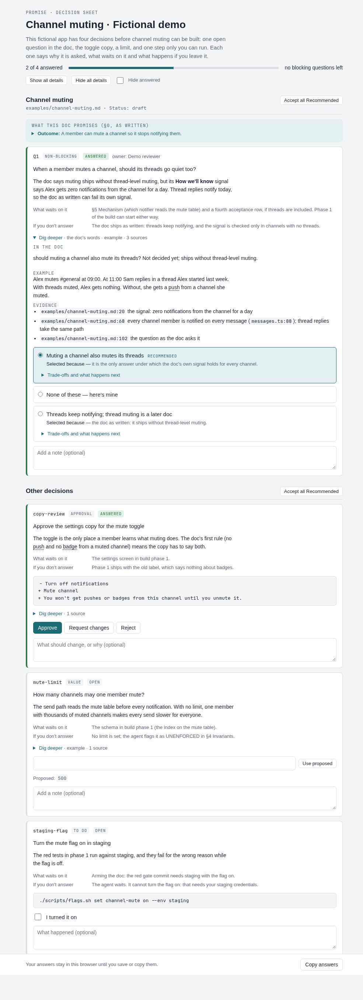
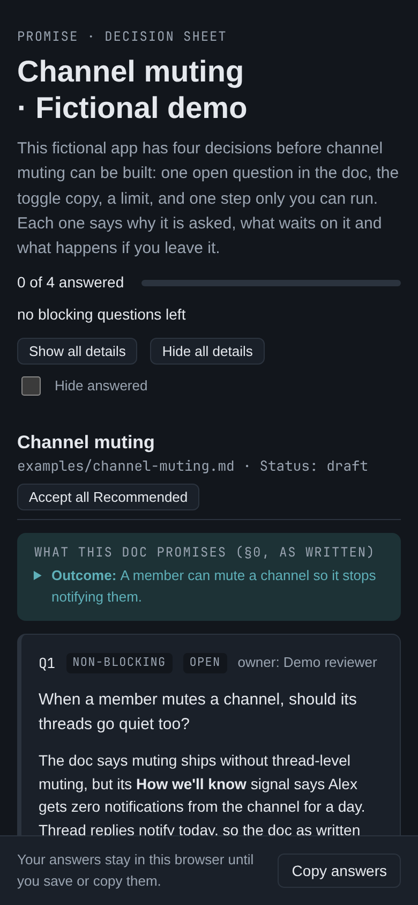
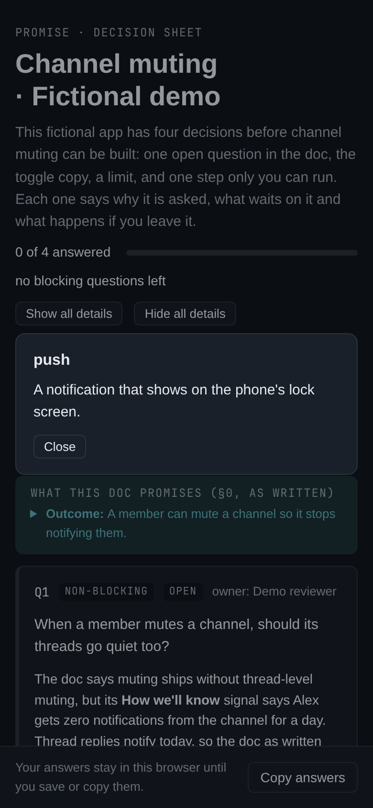

# A decision sheet, as the human sees it

Four decisions waiting on the owner of [`../channel-muting.md`](../channel-muting.md):
the doc's open question, a copy approval, a value and a step only they can run.
[`asks.json`](asks.json) is the agent's input; every other file here is made from
it by `decisions.py sheet`.



 

Words the reader may not know are underlined once on each card; a tap opens the
meaning. In a project with a capability map they come from its `glossary`, the same
list issues and pull requests use; this example has no map, so `asks.json` lists them
under `words`.

| File | What it is | Who sees it |
|---|---|---|
| [`sheet.html`](sheet.html) | The page. In Claude it is published as an Artifact with the `db` capability, and **Save answers for Claude** writes the answers to its database; opened anywhere else, **Copy answers** puts them on the clipboard. | The human |
| [`chat.md`](chat.md) | The same sheet as one chat message, for a chat that shows only text: numbered items, lettered choices, and how to reply (`all recommended`, `1a 2c`). | The human |
| [`comment.md`](comment.md) | The chat message for a GitHub issue or pull request, the full detail folded under it, and the sheet's data in an HTML comment so any agent can apply the reply. | The human, and the agent that applies the reply |
| [`sheet.md`](sheet.md) | The Markdown twin: every item in full. | Agents; never sent to the human as the way to answer |

To open the page, download `sheet.html` and open it in a browser; GitHub shows its
source, not the page. The screenshots use fictional names and answers. The
desktop view shows the first question and the copy approval answered, with the
first question's **Dig deeper** open. The Save button shows only inside a Claude Artifact.

Made with:

```
python3 skills/promise/scripts/decisions.py sheet examples/channel-muting.md \
  --asks examples/decisions/asks.json --out examples/decisions/sheet.html
python3 skills/promise/scripts/decisions.py sheet examples/channel-muting.md \
  --asks examples/decisions/asks.json --md examples/decisions/sheet.md
python3 skills/promise/scripts/decisions.py sheet examples/channel-muting.md \
  --asks examples/decisions/asks.json --chat examples/decisions/chat.md
python3 skills/promise/scripts/decisions.py sheet examples/channel-muting.md \
  --asks examples/decisions/asks.json --comment examples/decisions/comment.md
```

`tests/test_examples.py` fails when these files fall behind the page template or
the script. The screenshots are not checked: retake them when the page changes.
